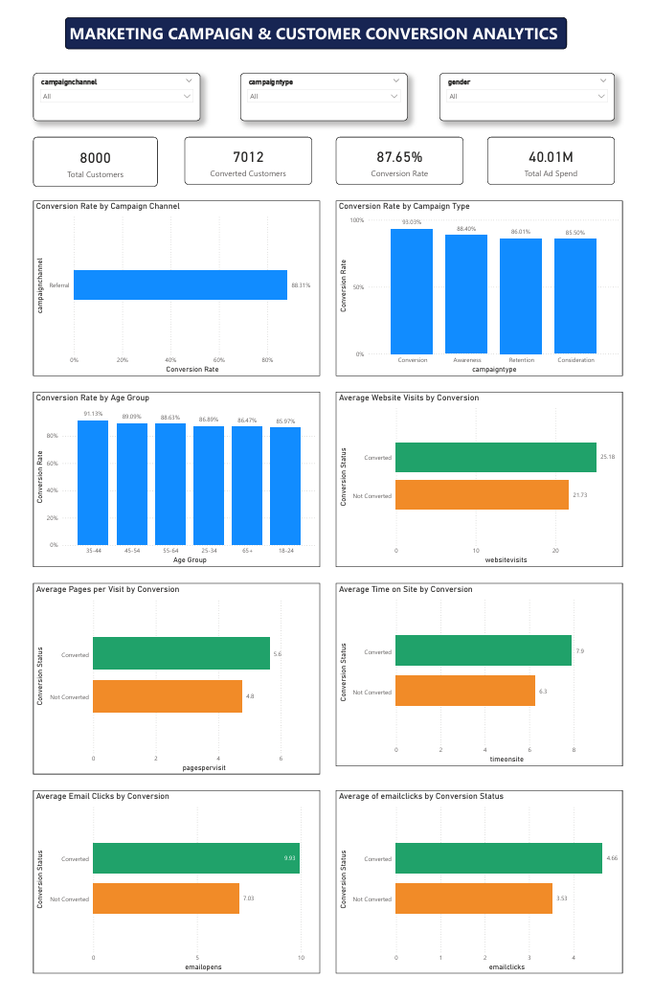
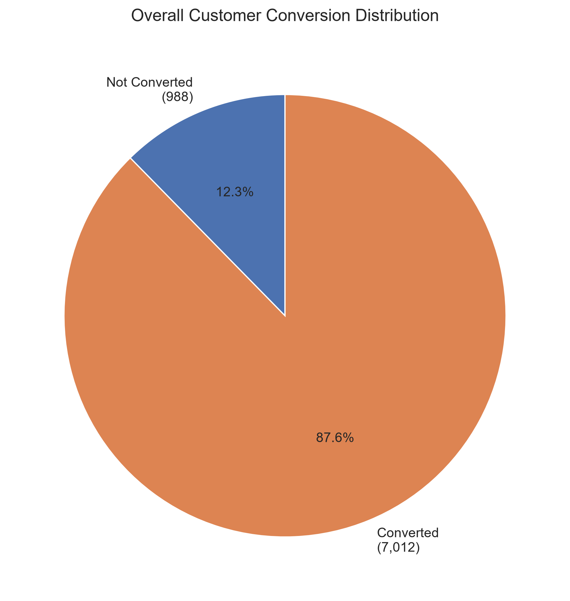
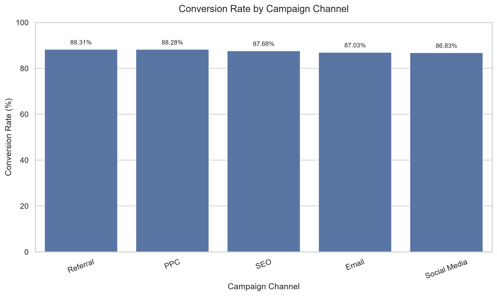
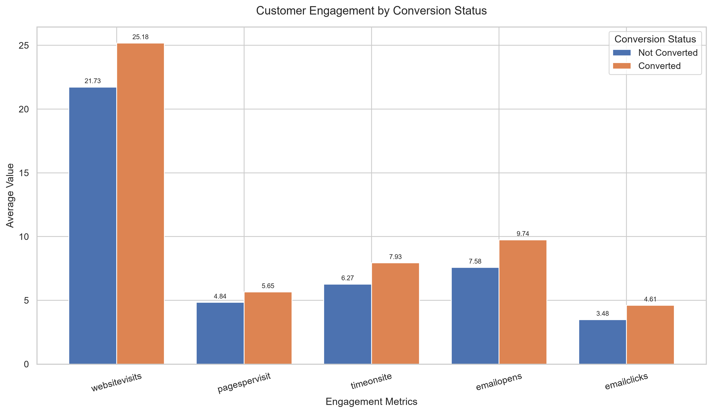

# Marketing Campaign & Customer Conversion Analytics

## Project Overview

An end-to-end data analytics project focused on evaluating digital marketing campaign performance, customer conversion behavior, advertising expenditure, and customer engagement.

This project uses **PostgreSQL, SQL, Python, and Power BI** to transform raw marketing data into meaningful insights. It analyzes how different campaign channels, campaign types, customer demographics, engagement activities, and advertising spend relate to customer conversions.

The objective is to identify high-performing marketing channels, understand customer engagement patterns, compare campaign effectiveness, and build an interactive dashboard for data-driven decision-making.

## Business Objectives

- Evaluate overall marketing campaign performance and customer conversion rates.
- Compare conversion performance across different marketing channels.
- Identify campaign types with higher customer conversion rates.
- Analyze customer demographics, including age, gender, and income.
- Understand the relationship between customer engagement and conversions.
- Examine advertising expenditure across different conversion segments.
- Identify patterns in previous purchases and customer loyalty points.
- Build an interactive Power BI dashboard to communicate key findings.

## Tools & Technologies

| Tool / Technology | Purpose |
|---|---|
| PostgreSQL 18 | Database management and SQL analysis |
| pgAdmin 4 | Database administration and query execution |
| SQL | Data analysis, aggregations, CTEs, and window functions |
| Python 3.11 | Data profiling, cleaning, validation, and visualization |
| Pandas & NumPy | Data manipulation and analysis |
| Matplotlib & Seaborn | Data visualization |
| Psycopg2 | PostgreSQL database connectivity |
| Power BI Desktop | Interactive dashboard development |
| Git & GitHub | Project version control and documentation |

## Dataset Information

**Dataset:** Predict Conversion in Digital Marketing Dataset  
**Source:** Kaggle  
**Author:** Rabie El Kharoua

The original dataset contains:

- 8,000 customer records
- 20 columns
- Customer demographic information
- Digital marketing campaign details
- Advertising expenditure
- Customer engagement metrics
- Customer conversion information

### Data Cleaning & Preparation

The dataset was processed using Python.

Key preparation activities included:

- Inspected dataset structure, data types, and statistical summaries.
- Checked for missing values and duplicate records.
- Removed two constant columns: `AdvertisingPlatform` and `AdvertisingTool`.
- Standardized column names to lowercase.
- Validated customer IDs and conversion values.
- Prepared a cleaned dataset for PostgreSQL and Power BI.

**Final cleaned dataset:**

| Validation Metric | Result |
|---|---:|
| Total Records | 8,000 |
| Total Columns | 18 |
| Missing Values | 0 |
| Duplicate Records | 0 |
| Unique Customer IDs | 8,000 |

## Project Workflow

### 1. Data Profiling & Cleaning – Python

- Inspected the raw dataset.
- Performed exploratory data profiling.
- Identified constant columns.
- Cleaned and standardized column names.
- Validated the final dataset.

### 2. Database Management – PostgreSQL

- Created the `marketing_campaign_db` database.
- Designed the `marketing_campaigns` table.
- Imported the cleaned CSV dataset.
- Validated the imported records and column structure.

### 3. SQL Analysis

Performed seven major areas of SQL analysis:

1. Overall Marketing Performance Analysis
2. Campaign Channel Analysis
3. Campaign Type Analysis
4. Customer Demographics Analysis
5. Customer Engagement Analysis
6. Advertising Spend Analysis
7. Advanced SQL Analysis

Advanced SQL techniques included:

- Aggregate functions
- GROUP BY and HAVING
- CASE statements
- Common Table Expressions (CTEs)
- Subqueries
- Window functions
- RANK(), DENSE_RANK(), and ROW_NUMBER()
- NTILE()
- AVG() OVER()
- Correlation analysis

### 4. Python Data Analysis & Visualization

Used Python to analyze data directly from PostgreSQL and generate six visualizations:

- Customer Conversion Distribution
- Conversion Rate by Campaign Channel
- Conversion Rate by Campaign Type
- Conversion Rate by Age Group
- Customer Engagement Analysis
- Advertising Spend vs. Conversion Analysis

### 5. Power BI Dashboard

Developed an interactive dashboard to present the key marketing performance metrics and analytical findings.

**Dashboard Features:**

- Total Customers
- Converted Customers
- Overall Conversion Rate
- Total Advertising Spend
- Conversion Rate by Campaign Channel
- Conversion Rate by Campaign Type
- Conversion Rate by Age Group
- Customer Engagement Comparison
- Interactive Campaign Channel, Campaign Type, and Gender slicers

**Dashboard Files:**

- [Power BI Dashboard (PBIX)](powerbi/Marketing_Campaign_Analytics.pbix)
- [Dashboard PDF](reports/Marketing_Campaign_Dashboard.pdf)

## 📊 Project Visualizations

### Power BI Dashboard



**Dashboard Files:**
- [View Interactive Power BI Dashboard](powerbi/Marketing_Campaign_Analytics.pbix)
- [View Dashboard PDF Report](reports/Marketing_Campaign_Dashboard.pdf)

### Conversion Distribution



### Channel-wise Conversion Analysis



### Customer Engagement Analysis



## Key Business Insights

### 1. Overall Campaign Performance

| Metric | Result |
|---|---:|
| Total Customers | 8,000 |
| Converted Customers | 7,012 |
| Not Converted Customers | 988 |
| Overall Conversion Rate | 87.65% |
| Total Advertising Spend | 40,007,558.64 |

The dataset shows an overall customer conversion rate of 87.65%.

### 2. Campaign Channel Performance

| Campaign Channel | Conversion Rate |
|---|---:|
| Referral | 88.31% |
| PPC | 88.28% |
| SEO | 87.68% |
| Email | 87.03% |
| Social Media | 86.83% |

**Insight:** Referral recorded the highest conversion rate at 88.31%, closely followed by PPC at 88.28%. Social Media recorded the lowest rate at 86.83%.

### 3. Campaign Type Performance

| Campaign Type | Conversion Rate |
|---|---:|
| Conversion | 93.36% |
| Retention | 85.82% |
| Awareness | 85.56% |
| Consideration | 85.56% |

**Insight:** The Conversion campaign type achieved the highest conversion rate at 93.36%, outperforming the other campaign categories.

### 4. Customer Demographics

- The 35–44 age group recorded the highest conversion rate at 89.59%.
- The 18–24 age group recorded a conversion rate of 86.13%.
- Male and female conversion rates were nearly identical.
- High-income customers recorded a conversion rate of 88.32%.

**Insight:** Conversion performance was relatively consistent across demographic segments, with the 35–44 age group showing the strongest result.

### 5. Customer Engagement Analysis

Converted customers showed higher average engagement than non-converted customers.

| Engagement Metric | Converted | Not Converted |
|---|---:|---:|
| Website Visits | 25.18 | 21.73 |
| Pages per Visit | 5.65 | 4.84 |
| Time on Site | 7.93 | 6.27 |
| Email Opens | 9.74 | 7.58 |
| Email Clicks | 4.61 | 3.48 |

**Insight:** Customers who converted generally demonstrated higher website activity and email engagement.

### 6. Advertising Spend Analysis

Customers were segmented into four advertising spend quartiles.

| Advertising Spend Segment | Conversion Rate |
|---|---:|
| Low | 82.80% |
| Medium | 83.25% |
| High | 92.15% |
| Very High | 92.40% |

**Insight:** Higher advertising spend segments showed higher observed conversion rates in this dataset. However, this relationship alone does not establish that increased spending causes higher conversions.

## Project Structure

```text
marketing-campaign-conversion-analytics/
│
├── dataset/
│   ├── digital_marketing_campaign_dataset.csv
│   └── processed/
│       └── marketing_campaign_cleaned.csv
│
├── python/
│   ├── inspect_dataset.py
│   ├── data_profiling.py
│   ├── conversion_analysis.py
│   ├── clean_dataset.py
│   ├── validate_dataset.py
│   └── visualizations.py
│
├── sql/
│   ├── 01_overall_performance.sql
│   ├── 02_campaign_channel_analysis.sql
│   ├── 03_campaign_type_analysis.sql
│   ├── 04_customer_demographics_analysis.sql
│   ├── 05_customer_engagement_analysis.sql
│   ├── 06_advertising_spend_analysis.sql
│   └── 07_advanced_sql_analysis.sql
│
├── powerbi/
│   └── Marketing_Campaign_Analytics.pbix
│
├── reports/
│   ├── 01_conversion_distribution.png
│   ├── 02_channel_conversion.png
│   ├── 03_campaign_type_conversion.png
│   ├── 04_age_group_conversion.png
│   ├── 05_customer_engagement.png
│   ├── 06_ad_spend_conversion.png
│   └── Marketing_Campaign_Dashboard.pdf
│
├── screenshots/
│
├── README.md
└── requirements.txt
```

## Skills Demonstrated

- Data Cleaning & Data Validation
- Exploratory Data Analysis (EDA)
- PostgreSQL & Advanced SQL
- Data Aggregation & Statistical Analysis
- Common Table Expressions (CTEs)
- SQL Window Functions
- Python Data Analysis
- Data Visualization
- Power BI Dashboard Development
- Business Intelligence & Data Storytelling
- Analytical Thinking & Insight Generation

## Limitations & Considerations

- The project uses an educational dataset and should not be interpreted as actual company marketing performance.
- The dataset does not contain a campaign date or timestamp, so time-based and trend analysis could not be performed.
- Actual revenue and profit information is unavailable; therefore, revenue-based ROI and ROAS calculations are outside the scope of this analysis.
- Advertising spend and conversion patterns indicate associations, not proven causal relationships.
- The unusually high overall conversion rate should be considered when interpreting the findings.

## Conclusion

This project demonstrates an end-to-end marketing analytics workflow, from raw data inspection and cleaning to SQL-based analysis, Python visualization, and interactive Power BI reporting.

The analysis highlights differences in campaign channel and campaign type performance, customer engagement patterns, demographic behavior, and advertising spend segments.

By combining SQL, Python, PostgreSQL, and Power BI, this project demonstrates practical data analytics skills and the ability to translate structured data into meaningful business insights.

---

**Project Category:** Marketing Analytics | Customer Conversion Analytics | Business Intelligence

**Tools:** PostgreSQL | SQL | Python | Power BI